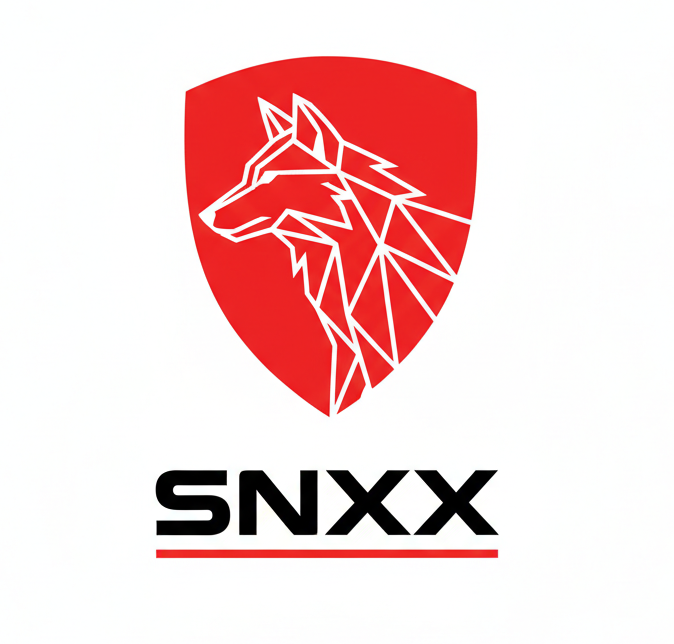

  

<h1 align="center">RTA-SNXX</h1>

  Public documentation for adopting red-team skill modules into the SNXX runtime: architecture decisions, license boundaries, workflow, verification summary, and open roadmap.

  <strong>English</strong> · <a href="README.md">Bahasa Indonesia</a>

> **Repository:** `RTA-SNXX-20261020`

> **Sanitized public edition.** Local paths, build identity, raw logs, scanner finding details, artifact checksums, and internal configuration are replaced with `[Redacted 0xnhsec]`. This repository does **not** distribute skill source, payloads, or operational packages.

## Project name

| Part | Meaning |
|---|---|
| **RTA** | *Red Team Agent* |
| **SNXX** | A proper noun; not an acronym |
| **20261020** | Date in `YYMMDD` format: 20 October 2026 |

Full name: **RTA-SNXX-20261020** — *Red Team Agent — SNXX — 20 October 2026*.

Project logo: [`snxx-project.png`](snxx-project.png).

## Overview

This project documents Phase 1 adoption of four skill sources into SNXX. Five MIT modules were adopted into the optional tier, two pilots (`re-code` and `web-pentest`) followed the same path, and `red-ctf` was separated into a GPL-3.0 package outside the MIT tree. Offensive modules remain opt-in; the default profile is not populated automatically.

Phase 1 verification result: **1888 passed, 1 skipped** in the skill suite, **90/90** adoption contracts, **12/12** opt-out invariants, **90/90** module tests, and a clean lint run. The single skip is a Windows-only contract test running on a Linux host.

## Status

| Area | Status |
|---|---|
| Five MIT modules | Complete and verified |
| `re-code` pilot | Complete and verified |
| `web-pentest` merge | Complete and verified |
| `red-ctf` GPL-3.0 | Separate package; load-path verified, end-to-end solve not yet |
| Default profile | 54 skills enabled; no `red-*` |
| Public documentation | Sanitized edition in this repository |
| Next phase | `red-reverse` Phase 2, Wave 2/3, branding sweep |

## Documentation map

| Document | Contents |
|---|---|
| [Scope and authorization](docs/en/00-SCOPE.md) | Work boundaries, network profile, and disallowed claims |
| [Adoption report](docs/en/01-ADOPTION-REPORT.md) | Main report, results, evidence chain, claim boundaries |
| [Workflow](docs/en/02-WORKFLOW.md) | End-to-end workflow, gates, exceptions, rollback |
| [Architecture](docs/en/03-ARCHITECTURE.md) | System layers, trust tiers, license boundary, runtime lifecycle |
| [Verification](docs/en/04-VERIFICATION.md) | Verification model, summary results, evidence integrity |
| [Publication and redaction](docs/en/05-PUBLICATION.md) | Exposure matrix, redaction rules, publication checklist |
| [Roadmap and gaps](docs/en/06-ROADMAP.md) | Work not yet claimed complete |
| [Mermaid diagrams](docs/en/diagrams/) | Raw `.mmd` files for adoption, verification, and runtime flows |

## Start reading

1. Read [scope and authorization](docs/en/00-SCOPE.md) to understand the work boundaries.
2. Read the [adoption report](docs/en/01-ADOPTION-REPORT.md) for results and claim boundaries.
3. Read the [workflow](docs/en/02-WORKFLOW.md) for the sequence and decision gates.
4. Read the [architecture](docs/en/03-ARCHITECTURE.md) for trust tiers and license separation.
5. Use the [roadmap](docs/en/06-ROADMAP.md) to see what remains open.

## Scope

**Included in the public documentation:**

- Architecture summary and module catalog.
- Adoption, verification, and opt-in usage flow.
- Summary test results and installation status.
- Redaction policy and claim boundaries.
- Mermaid workflow diagrams.

**Not included:**

- Skill source code or payloads.
- Absolute paths, hostnames, credentials, and runtime configuration.
- Raw logs, scanner finding details, and internal artifact checksums.
- GPL distribution packages and unsanitized operational guidance.
- Performance claims or real-target completion results.

## Principles

- **Opt-in by default.** Offensive modules must not activate automatically.
- **License boundary is a hard gate.** MIT and GPL-3.0 are not mixed in one distribution tree.
- **Evidence before claim.** Every status claim must have a verification trail.
- **Public means sanitized.** Details not needed to understand a decision are not published.
- **Phase 1 is not the whole roadmap.** Six modules do not replace the entire source catalog.

## License

This documentation repository follows the `LICENSE` at the repository root. Adopted modules retain their original licenses: MIT for the five core modules and pilots, GPL-3.0 for the separated `red-ctf`. This documentation does not change the license of third-party code.
