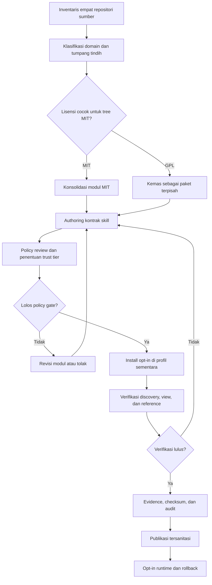
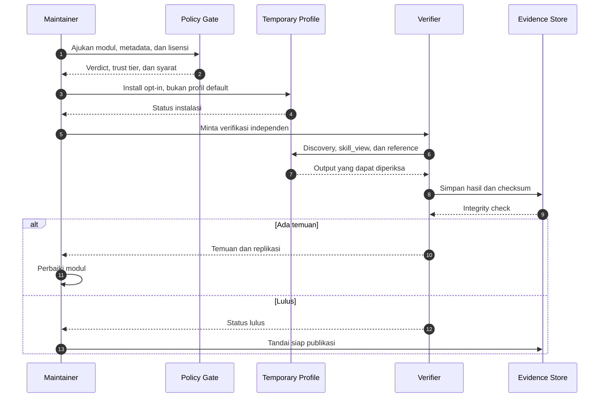
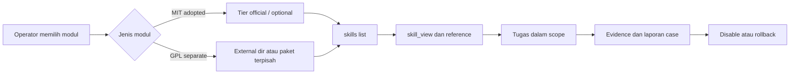

# Flow kerja adopsi dan operasi

Dokumen ini menjelaskan alur kerja dari inventaris sumber sampai modul dapat dipakai secara opt-in. Fokusnya adalah gate keputusan dan bukti yang harus ada di setiap tahap, bukan perintah internal yang bersifat rahasia.

## 1. Prinsip alur kerja

- **Satu tahap, satu output.** Setiap tahap harus menghasilkan artefak yang bisa diperiksa tahap berikutnya.
- **Lisensi lebih dulu.** Modul GPL tidak boleh masuk ke tree MIT hanya karena strukturnya cocok.
- **Policy sebelum install.** Modul ofensif tidak diuji dengan mengaktifkannya di profil default.
- **Verifikasi independen.** Install yang berhasil belum berarti modul dapat ditemukan dan dibaca.
- **Publikasi adalah tahap terpisah.** Dokumentasi tidak otomatis mengikuti bukti internal; harus melalui redaksi.

## 2. Alur utama

File mentah: [`diagrams/01-adoption-workflow.mmd`](diagrams/01-adoption-workflow.mmd).

## 3. Tahapan dan gate

| Tahap | Input | Output | Gate | Jika gagal |
|---:|---|---|---|---|
| 1. Inventaris | Empat repositori sumber | Daftar skill, lisensi, domain, duplikasi | Cakupan jelas | Perbaiki daftar sebelum lanjut |
| 2. Klasifikasi | Daftar inventaris | Keputusan Direct/Adapt/Merge/Optional/Hold | Tidak ada duplikasi semantik | Gabungkan atau tahan |
| 3. Lisensi | Klasifikasi | Batas MIT vs GPL | GPL tidak masuk tree MIT | Pisahkan paket |
| 4. Authoring | Modul domain | `SKILL.md` dan reference | Kontrak frontmatter, trigger, prerequisite, tool mapping | Revisi modul |
| 5. Policy | Modul final | Verdict dan trust tier | Modul ofensif tidak memakai project tier | Ubah tier atau tolak |
| 6. Install | Modul lolos policy | Status install di profil sementara | Default profile tidak berubah | Hapus profil dan revisi |
| 7. Verifikasi | Modul terpasang | Discovery, view, reference, test | Semua pemeriksaan lulus | Kembali ke authoring |
| 8. Evidence | Hasil verifikasi | Log, checksum, ringkasan | Integritas checksum valid | Ulangi verifikasi |
| 9. Publikasi | Evidence dan dokumen | Dokumen publik tersanitasi | Tidak ada data internal | Redaksi ulang |

## 4. Alur verifikasi

File mentah: [`diagrams/02-verification-workflow.mmd`](diagrams/02-verification-workflow.mmd).

## 5. Alur runtime

File mentah: [`diagrams/03-runtime-load-flow.mmd`](diagrams/03-runtime-load-flow.mmd).

## 6. Gate keputusan

### 6.1 Gate lisensi

Modul hanya boleh masuk tree MIT jika lisensi sumber kompatibel. Modul GPL harus memiliki paket, `LICENSE`, dan jalur distribusi sendiri. Tidak ada penyalinan kode GPL ke tree MIT.

### 6.2 Gate policy

Modul ofensif tidak boleh diuji lewat project tier yang akan mengarantina konten `dangerous`. Jalur yang dipakai adalah tier official dengan trust `builtin`, dan tetap opt-in.

### 6.3 Gate instalasi

Install hanya boleh dilakukan di profil sementara. Setelah verifikasi, profil dihapus. Profil default harus tetap bersih dan jumlah skill `red-*` harus nol.

### 6.4 Gate verifikasi

Minimal yang harus lulus:

- modul ditemukan oleh `skills list`;
- `SKILL.md` dapat dibaca;
- reference utama dapat dibaca;
- kontrak dan invariant lulus;
- tidak ada perubahan core runtime;
- checksum evidence valid.

### 6.5 Gate publikasi

Dokumen publik tidak boleh memuat path absolut, identitas host, log mentah, detail finding scanner, checksum artefak, paket distribusi, atau payload. Gunakan `[Redacted 0xnhsec]` untuk informasi yang sengaja ditahan.

## 7. Exception path

| Kondisi | Tindakan |
|---|---|
| Lisensi tidak kompatibel | Pisahkan paket; jangan paksakan ke tree MIT |
| Modul bertabrakan dengan skill existing | Merge atau tahan; jangan menambah duplikasi |
| Policy menolak | Revisi konten atau ubah jalur distribusi yang sah |
| Install gagal | Hapus profil sementara dan baca error; jangan mengubah default |
| Discovery gagal | Periksa nama folder, frontmatter, dan `external_dirs` |
| Reference tidak terbaca | Perbaiki routing atau path reference |
| Test gagal | Kembali ke authoring; jangan menandai selesai |
| Checksum tidak cocok | Ulangi evidence capture; jangan publikasikan |

## 8. Rollback

Rollback dilakukan dengan urutan:

1. Nonaktifkan modul melalui `skills.disabled`.
2. Hapus instalasi dari profil sementara atau `external_dirs`.
3. Pastikan profil default kembali ke kondisi sebelumnya.
4. Simpan catatan kegagalan sebagai evidence internal.
5. Perbaiki modul dan ulangi dari gate authoring, bukan langsung install.

## 9. Peran dan tanggung jawab

| Peran | Tanggung jawab |
|---|---|
| Maintainer modul | Menyusun kontrak, reference, dan metadata |
| Policy reviewer | Menentukan verdict, trust tier, dan syarat |
| Verifier | Menguji discovery, view, reference, dan integritas evidence |
| Operator | Mengaktifkan modul secara opt-in dan menjaga scope |
| Publisher | Menyensor data internal dan memeriksa dokumen publik |

## 10. Definition of done Phase 1

Phase 1 dianggap selesai jika:

- modul yang diklaim adopted benar-benar berada di tree yang benar;
- kontrak, invariant, dan test modul lulus;
- install opt-in terbukti dan default profile tetap bersih;
- lisensi GPL terpisah dari tree MIT;
- evidence memiliki checksum yang valid;
- dokumen publik sudah melalui redaksi;
- gap fungsional tetap dicatat dan tidak diklaim selesai.
