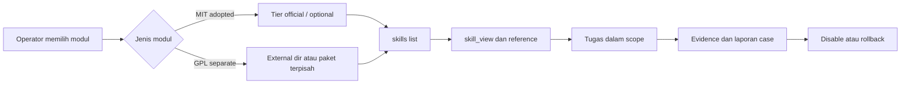

# Arsitektur dan batas kepercayaan

Dokumen ini menjelaskan lapisan sistem, trust tier, dan batas lisensi yang membentuk adopsi Phase 1. Implementasi internal dan identifier runtime yang tidak perlu dipublikasikan diganti dengan `[Redacted 0xnhsec]`.

## 1. Lapisan sistem

| Lapisan | Peran | Artefak publik |
|---|---|---|
| Sumber | Repositori skill asal dan referensi | Nama sumber, lisensi, domain |
| Konsolidasi | Pengelompokan skill menjadi modul domain | Katalog modul dan jumlah reference |
| Kontrak | Frontmatter, trigger, prerequisite, tool mapping, routing | Struktur `SKILL.md` yang dijelaskan |
| Policy | Penilaian trust, verdict, dan izin install | Ringkasan gate dan tier |
| Runtime | Discovery, pemilihan, pembacaan reference | Alur `skills list` dan `skill_view` |
| Evidence | Test, install log, checksum, audit | Ringkasan hasil dan batas klaim |
| Publikasi | Redaksi dan dokumentasi | Repositori ini |

## 2. Alur nilai

```text
Skill tersebar
  -> modul domain
  -> kontrak yang dapat diaudit
  -> policy gate
  -> instalasi opt-in
  -> verifikasi
  -> penggunaan dalam scope
  -> evidence dan laporan
```

Konsolidasi bukan tujuan akhir. Tujuannya adalah membuat modul lebih mudah dipilih, diuji, dan dipertanggungjawabkan tanpa menghilangkan reference yang diperlukan.

## 3. Trust tier

| Tier | Karakter | Penggunaan |
|---|---|---|
| **Official** | Trust `builtin`; policy dapat mengizinkan modul berisiko tinggi | Modul adopted dan pilot yang sudah lolos review |
| **Project** | Lebih ketat; modul `dangerous` dapat dikarantina | Tidak dipakai untuk modul ofensif Phase 1 |
| **External/local** | Modul berada di luar tree, didaftarkan lewat `external_dirs` | `red-ctf` GPL dan paket terpisah |
| **Default profile** | Profil yang dipakai tanpa opt-in | Tidak berisi `red-*` |

Prinsipnya: **modul ofensif tidak boleh bergantung pada tier yang lebih longgar untuk menghindari review**. Jalur official dipakai karena memang jalur distribusi yang tepat, bukan karena ingin melewati policy.

## 4. Batas lisensi

| Komponen | Lisensi | Lokasi distribusi |
|---|---|---|
| Lima modul inti | MIT | Tree `optional-skills/security/` |
| `re-code` | MIT | Tree `optional-skills/security/reverse/` |
| `web-pentest` | MIT | Tree `optional-skills/security/web-pentest/` |
| `red-ctf` | GPL-3.0 | Paket terpisah dan `external_dirs` |
| Dokumentasi ini | Mengikuti `LICENSE` repositori | Repositori dokumentasi |

Aturan keras:

1. `red-ctf` tidak boleh disalin ke tree MIT.
2. Paket GPL harus membawa `LICENSE` sendiri.
3. Dokumentasi tidak boleh menyiratkan bahwa lisensi modul berubah.
4. Publikasi dokumen tidak sama dengan publikasi paket.

## 5. Runtime lifecycle



File mentah: [`diagrams/03-runtime-load-flow.mmd`](diagrams/03-runtime-load-flow.mmd).

Lifecycle operasional:

1. **Discovery.** Runtime menemukan modul dari tree atau `external_dirs`.
2. **Selection.** Operator memilih modul yang relevan; tidak ada auto-activation untuk modul ofensif.
3. **Read.** `skill_view` membaca `SKILL.md` dan reference yang dirutekan.
4. **Execute.** Skill dipakai dalam scope yang sudah disetujui.
5. **Record.** Hasil kerja dicatat sebagai evidence case.
6. **Disable/rollback.** Modul dinonaktifkan setelah engagement atau jika terjadi masalah.

## 6. Katalog domain

| Domain | Modul | Cakupan |
|---|---|---|
| Reverse engineering | `red-reverse`, `re-code` | Binary, firmware, native code, workflow evidence |
| Offensive | `red-offensive` | AD/identity, cloud, exploit, evasion, attack chain |
| Web/AppSec | `red-web`, `web-pentest` | Web/API, code audit, database, LLM, supply chain |
| Forensics | `red-forensics` | DFIR, malware, threat hunting, threat intelligence |
| Hardware | `red-hardware` | Mobile, firmware, hardware, OT/ICS, RF, Wi-Fi |
| CTF | `red-ctf` | Orchestration dan domain child, paket GPL terpisah |

## 7. Batas kepercayaan dokumentasi

Dokumen publik ini menjelaskan **mengapa** dan **bagaimana** adopsi dilakukan, tetapi tidak memberikan:

- path absolut atau nama host;
- konfigurasi runtime;
- payload atau contoh command ofensif;
- log mentah dan detail finding;
- checksum atau artefak paket;
- kredensial dan identifier internal.

Pembaca dapat memahami arsitektur dan gate tanpa memperoleh bahan operasional yang tidak semestinya dibagikan. Detail kategori ada di [kebijakan publikasi](05-PUBLICATION.md).
