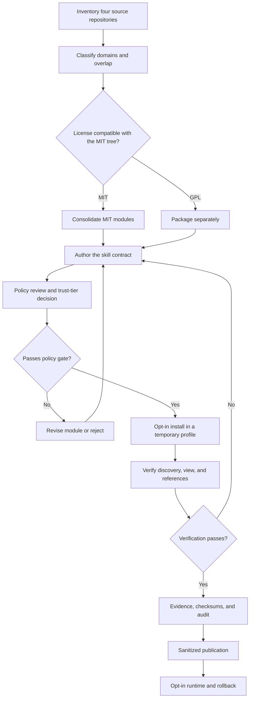
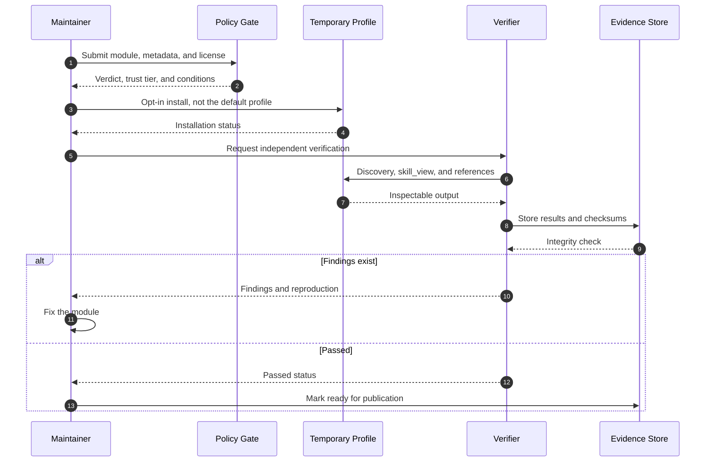
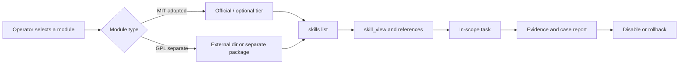

# Adoption and operations workflow

This document describes the workflow from source inventory to an opt-in module ready for use. It focuses on decision gates and the evidence required at each stage, not on private internal commands.

## 1. Workflow principles

- **One stage, one output.** Every stage must produce an artifact that the next stage can inspect.
- **License first.** A GPL module must not enter the MIT tree simply because its structure fits.
- **Policy before installation.** Offensive modules are not tested by activating them in the default profile.
- **Independent verification.** A successful install does not prove that the module can be discovered and read.
- **Publication is a separate stage.** Documentation does not automatically follow internal evidence; it must pass redaction.

## 2. Main flow

Raw file: [`diagrams/01-adoption-workflow.mmd`](diagrams/01-adoption-workflow.mmd).

## 3. Stages and gates

| Stage | Input | Output | Gate | If it fails |
|---:|---|---|---|---|
| 1. Inventory | Four source repositories | Skill list, licenses, domains, duplicates | Clear scope | Fix the inventory before proceeding |
| 2. Classification | Inventory list | Direct/Adapt/Merge/Optional/Hold decision | No semantic duplicates | Merge or hold |
| 3. License | Classification | MIT vs GPL boundary | GPL does not enter the MIT tree | Separate the package |
| 4. Authoring | Domain modules | `SKILL.md` and references | Frontmatter, trigger, prerequisite, tool mapping | Revise the module |
| 5. Policy | Final module | Verdict and trust tier | Offensive modules do not use the project tier | Change tier or reject |
| 6. Install | Policy-approved module | Install status in a temporary profile | Default profile remains unchanged | Remove the profile and revise |
| 7. Verification | Installed module | Discovery, view, reference, tests | All checks pass | Return to authoring |
| 8. Evidence | Verification results | Logs, checksums, summary | Checksum integrity is valid | Repeat verification |
| 9. Publication | Evidence and documents | Sanitized public document | No internal data | Redact again |

## 4. Verification flow

Raw file: [`diagrams/02-verification-workflow.mmd`](diagrams/02-verification-workflow.mmd).

## 5. Runtime flow

Raw file: [`diagrams/03-runtime-load-flow.mmd`](diagrams/03-runtime-load-flow.mmd).

## 6. Decision gates

### 6.1 License gate

A module may enter the MIT tree only when the source license is compatible. GPL modules must have their own package, `LICENSE`, and distribution path. No GPL code is copied into the MIT tree.

### 6.2 Policy gate

Offensive modules must not be tested through a project tier that would quarantine `dangerous` content. The correct path is the official tier with `builtin` trust, while remaining opt-in.

### 6.3 Installation gate

Installation is allowed only in a temporary profile. After verification, the profile is removed. The default profile must remain clean and the number of `red-*` skills must be zero.

### 6.4 Verification gate

At minimum, the following must pass:

- the module is discovered by `skills list`;
- `SKILL.md` can be read;
- the main reference can be read;
- contracts and invariants pass;
- no core runtime changes are present;
- evidence checksums are valid.

### 6.5 Publication gate

Public documents must not contain absolute paths, host identity, raw logs, scanner finding details, artifact checksums, distribution packages, or payloads. Use `[Redacted 0xnhsec]` for information intentionally withheld.

## 7. Exception paths

| Condition | Action |
|---|---|
| Incompatible license | Separate the package; do not force it into the MIT tree |
| Module collides with an existing skill | Merge or hold; do not add duplication |
| Policy rejects the module | Revise the content or choose a legitimate distribution path |
| Installation fails | Remove the temporary profile and read the error; do not change the default |
| Discovery fails | Check the folder name, frontmatter, and `external_dirs` |
| Reference cannot be read | Fix routing or the reference path |
| Tests fail | Return to authoring; do not mark complete |
| Checksum mismatch | Repeat evidence capture; do not publish |

## 8. Rollback

Rollback follows this order:

1. Disable the module through `skills.disabled`.
2. Remove the installation from the temporary profile or `external_dirs`.
3. Confirm the default profile is back to its previous state.
4. Record the failure as internal evidence.
5. Fix the module and restart from the authoring gate, not directly from installation.

## 9. Roles and responsibilities

| Role | Responsibility |
|---|---|
| Module maintainer | Build the contract, references, and metadata |
| Policy reviewer | Determine the verdict, trust tier, and conditions |
| Verifier | Test discovery, view, references, and evidence integrity |
| Operator | Enable modules opt-in and preserve scope |
| Publisher | Redact internal data and review public documents |

## 10. Phase 1 definition of done

Phase 1 is complete when:

- modules claimed as adopted are in the correct tree;
- contracts, invariants, and module tests pass;
- opt-in installation is proven and the default profile remains clean;
- GPL licensing is separated from the MIT tree;
- evidence has valid checksums;
- public documents have passed redaction;
- functional gaps are recorded and not claimed complete.
