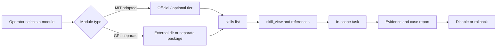

# Architecture and trust boundaries

This document explains the system layers, trust tiers, and license boundaries that shape Phase 1 adoption. Internal implementation details and runtime identifiers that do not need to be public are replaced with `[Redacted 0xnhsec]`.

## 1. System layers

| Layer | Role | Public artifact |
|---|---|---|
| Source | Original skill repositories and references | Source names, licenses, domains |
| Consolidation | Grouping skills into domain modules | Module catalog and reference counts |
| Contract | Frontmatter, triggers, prerequisites, tool mapping, routing | The documented `SKILL.md` structure |
| Policy | Trust assessment, verdict, and installation permission | Gate and tier summary |
| Runtime | Discovery, selection, reference reads | `skills list` and `skill_view` flow |
| Evidence | Tests, installation logs, checksums, audits | Result summary and claim boundaries |
| Publication | Redaction and documentation | This repository |

## 2. Value flow

```text
Scattered skills
  -> domain modules
  -> auditable contracts
  -> policy gate
  -> opt-in installation
  -> verification
  -> in-scope use
  -> evidence and reporting
```

Consolidation is not the end goal. The goal is to make modules easier to select, test, and account for without losing the references they need.

## 3. Trust tiers

| Tier | Character | Use |
|---|---|---|
| **Official** | `builtin` trust; policy may allow high-risk modules | Adopted and pilot modules that passed review |
| **Project** | Stricter; `dangerous` modules may be quarantined | Not used for Phase 1 offensive modules |
| **External/local** | Module is outside the tree, registered through `external_dirs` | `red-ctf` GPL and separate packages |
| **Default profile** | Profile used without opt-in | Contains no `red-*` |

The principle: **offensive modules must not rely on a looser tier to bypass review**. The official path is used because it is the correct distribution path, not because it avoids policy.

## 4. License boundary

| Component | License | Distribution location |
|---|---|---|
| Five core modules | MIT | `optional-skills/security/` tree |
| `re-code` | MIT | `optional-skills/security/reverse/` tree |
| `web-pentest` | MIT | `optional-skills/security/web-pentest/` tree |
| `red-ctf` | GPL-3.0 | Separate package and `external_dirs` |
| This documentation | Follows the repository `LICENSE` | Documentation repository |

Hard rules:

1. `red-ctf` must not be copied into the MIT tree.
2. The GPL package must carry its own `LICENSE`.
3. Documentation must not imply that a module's license has changed.
4. Publishing documentation is not the same as publishing a package.

## 5. Runtime lifecycle



Raw file: [`diagrams/03-runtime-load-flow.mmd`](diagrams/03-runtime-load-flow.mmd).

Operational lifecycle:

1. **Discovery.** The runtime finds modules in the tree or `external_dirs`.
2. **Selection.** The operator selects relevant modules; there is no auto-activation for offensive modules.
3. **Read.** `skill_view` reads `SKILL.md` and the routed references.
4. **Execute.** The skill is used within an approved scope.
5. **Record.** Work results are recorded as case evidence.
6. **Disable/rollback.** The module is disabled after the engagement or if a problem occurs.

## 6. Domain catalog

| Domain | Modules | Coverage |
|---|---|---|
| Reverse engineering | `red-reverse`, `re-code` | Binary, firmware, native code, evidence workflow |
| Offensive | `red-offensive` | AD/identity, cloud, exploit, evasion, attack chain |
| Web/AppSec | `red-web`, `web-pentest` | Web/API, code audit, database, LLM, supply chain |
| Forensics | `red-forensics` | DFIR, malware, threat hunting, threat intelligence |
| Hardware | `red-hardware` | Mobile, firmware, hardware, OT/ICS, RF, Wi-Fi |
| CTF | `red-ctf` | Orchestration and domain children, separate GPL package |

## 7. Documentation trust boundary

This public documentation explains **why** and **how** adoption was performed, but it does not provide:

- absolute paths or hostnames;
- runtime configuration;
- payloads or offensive command examples;
- raw logs and scanner finding details;
- package checksums or artifacts;
- credentials and internal identifiers.

Readers can understand the architecture and gates without receiving operational material that should not be shared. Category details are in the [publication policy](05-PUBLICATION.md).
